# Assignment 6. jQuery (Selectors, Effects, Animations)

**Name:** Ingkar Tolegen
**Group:** SE-2540

**GitHub Pages:** https://inkartolegen2.github.io/Assignment6-WEB1/
**URL:**  https://inkartolegen2.github.io/Assignment6-WEB1/

---

## Task 0. Setup
Include jQuery from a CDN, write a `$(document).ready()` function and print "jQuery is ready!" in the console.

## Task 1. Selectors & CSS
Display a name, a headline and an introduction. Use tag, ID and class selectors, update the text with `.text()` and `.html()`, change styles with `.css()` and add buttons to switch between light and dark themes.

Light theme:

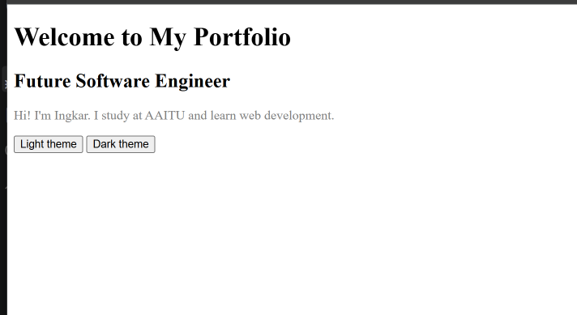

Dark theme:

## Task 2. Visibility Methods
Create an "About Me" section with a biography, a status message and fun facts. Add Hide, Show and Toggle buttons to control their visibility.

Initial view:

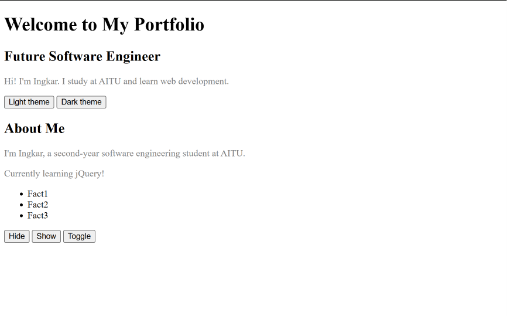

After Hide:

After Show:

After Toggle:

## Task 3. Fade Methods
Display two images and control them with `.fadeIn()`, `.fadeOut()` and `.fadeToggle()`.

Initial view:

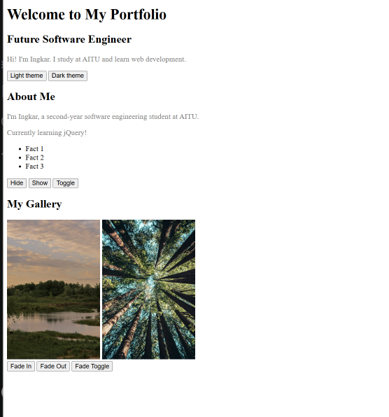

After Fade Out:

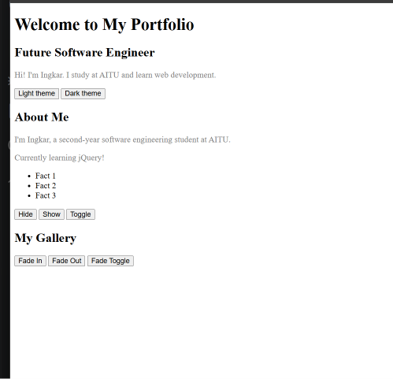

After Fade In:

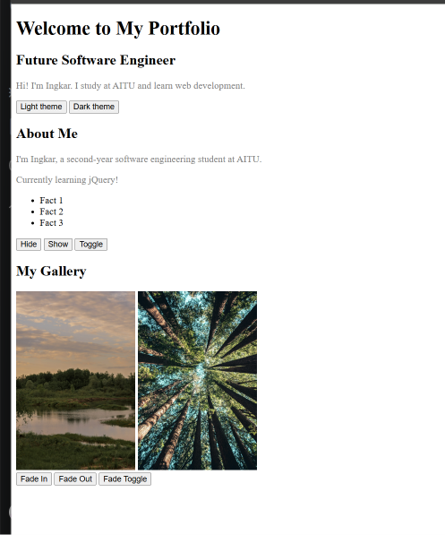

## Task 4. Slide Methods
Create three clickable headings with collapsible panels below them. The panels open and close smoothly with `.slideUp()`, `.slideDown()` and `.slideToggle()`.

All panels closed:

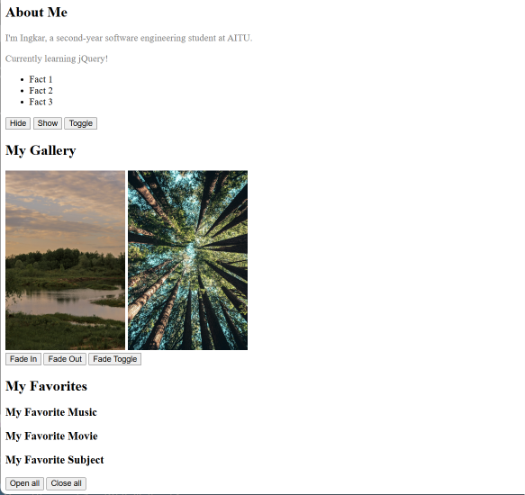

Panels opened:

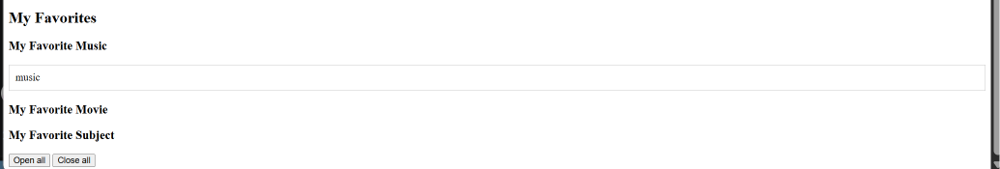

## Task 5. Add & Remove Elements
Display a list of four technical skills with a text input and three buttons: Add Skill (`.append()`), Prepend Skill (`.prepend()`) and Remove Skill (`.remove()`). Empty skills cannot be added.

Initial list:

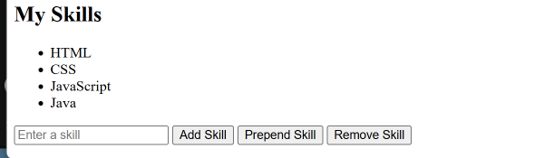

After adding a skill:

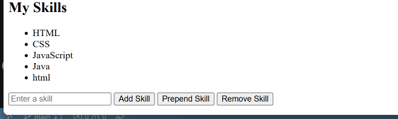

After prepending a skill:

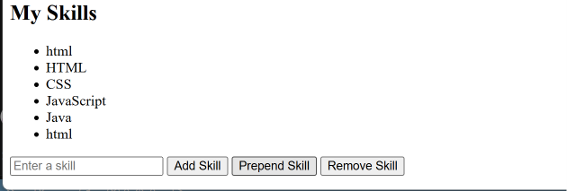

Error for an empty field:

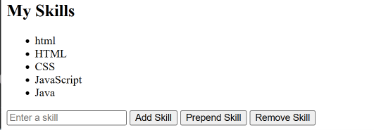

## Task 6. Modifying Attributes
Add a social media link and a button that changes its destination with `.attr()`.

Before:

After:

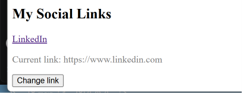

## Task 7. Form Interaction
Create a form with Name and Email inputs. The entered values are displayed live below the form using `.val()` and `.text()`.

Empty form:

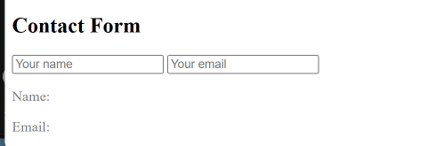

Live output:

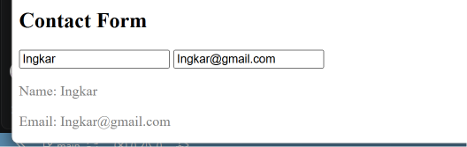

## Task 8. Basic Animation
Create skill bars for three technical skills (HTML 90%, CSS 75%, JavaScript 60%) and an "Animate My Skills" button. The bars start with zero width, grow to different target widths with `.animate()` and return to zero on the second click.

Zero width:

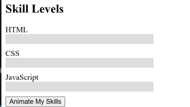

After animation:

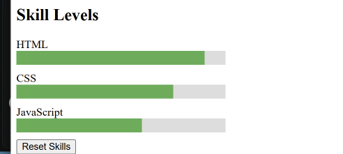

---

## Summary
I built a personal portfolio page with jQuery. First I connected jQuery from a CDN and practiced selectors, `.text()`, `.html()` and `.css()` for themes. Then I added effects (hide/show/toggle, fade and slide), DOM manipulation (adding and removing skills with validation, changing a link with `.attr()`, a live form) and finally animated skill bars with `.animate()`.

While working I fixed several problems: buttons disappeared because they were placed inside the hidden element, and the skill bars did not work because of a class name typo. I tested every task in the browser and made screenshots for the report. The project is uploaded to GitHub and published with GitHub Pages.